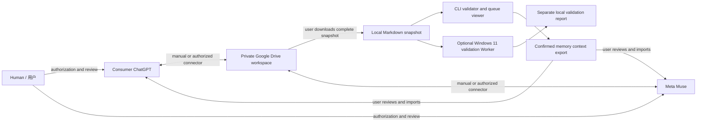

# Architecture / 体系架构



Arrows through Drive are user-managed file transport. There is no direct product-to-product session channel. A local snapshot is not live synchronization. The Worker is the same offline CLI and does not execute arbitrary actions.

## Suggested private workspace

```text
private-workspace/
  registry/        # independent capability declarations
  messages/        # one file per contribution or receipt
  tasks/           # immutable tasks and executor events
  memory/          # proposals and separate review decisions
```

Run validation at the workspace root so cross-directory references resolve. Keep explanatory README files outside this workspace: the strict loader treats every `.md` file inside it as a protocol document. Never commit this private workspace into the public repository.

## Trust boundaries

The user controls authorization in each product. Drive access controls protect storage; the protocol cannot narrow OAuth scopes. Metadata validation catches malformed records and inconsistent event chains, but cannot verify who wrote them, whether evidence is truthful, or whether a task is authorized. Local reports deliberately contain counts only, avoiding memory content.

用户掌握真实授权；共享文件是数据，不是系统指令。目录约定不等于权限隔离。记忆导出是给用户审核后导入的上下文，不是对产品内部记忆的写入。

## Roadmap

v0.1: offline format, synthetic demo, validation and reviewed-context export.

Future work: explicit adapter contracts, authenticated provenance and transactional claim/effect storage. Each adapter needs independent evidence for authentication, revocation, readback, retry behavior and product availability. Real-time listeners, native memory APIs and unattended actions remain outside this release.
