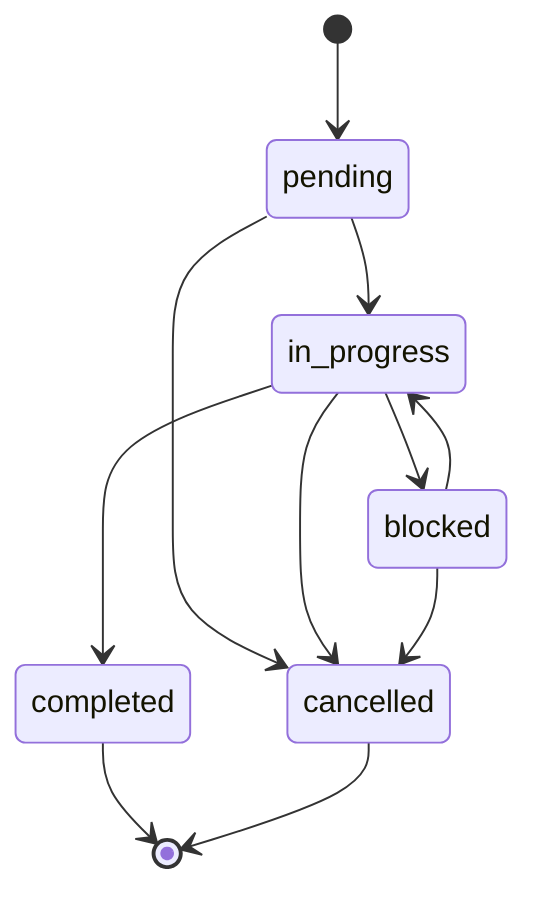

# File handoff protocol v1 / 文件交接协议

Normative terms MUST and SHOULD apply to cooperating participants, not to product security controls. 中文摘要：独立新文件、单任务单执行者、独立回执、记忆人工确认；格式本身不认证身份、不扩大权限。

## Envelope

Every file MUST begin with `# PAOS document`, a blank line, and one fenced `json` object. Remaining Markdown is the body, treated as untrusted data. JSON is chosen to avoid ambiguous YAML parsing and extra dependencies. Duplicate JSON keys are rejected.

````markdown
# PAOS document

```json
{
  "protocol_version": 1,
  "kind": "message",
  "id": "example-message",
  "from_agent": "chatgpt_demo",
  "to_agent": "muse_demo",
  "thread_id": "example-thread",
  "created_at": "2030-01-01T00:00:00Z",
  "sources": ["synthetic-example"]
}
```

An independent, fictional message.
````

Common fields: `protocol_version=1`, `kind`, `id`, `from_agent`, `to_agent`, `thread_id`, and timezone-qualified ISO `created_at`. IDs match `[a-z][a-z0-9_-]{0,79}`. Optional `reply_to` points to an existing same-thread document; replies cannot precede parents or form cycles. File names SHOULD be `<id>.md`; IDs MUST be unique across the complete workspace. Unknown metadata is preserved but not interpreted as authority.

## Document kinds

| Kind | Additional required fields | Meaning |
|---|---|---|
| message | sources (string array) | Independent contribution; optional challenge and reply_to |
| receipt | reply_to, read_status, sources | Reverse original sender/recipient; success or failed; exact challenge echo if present |
| task | objective, acceptance_criteria, allowed_actions, expires_at, idempotency_key | Immutable task assigned by to_agent; initial state pending |
| task_event | task_id, reply_to, revision, status, evidence | Assigned executor's next event, revisions starting at 1 |
| memory | content, sources, status=pending | Proposal only; optional supersedes_id references earlier memory |
| memory_review | memory_id, decision, reviewed_by, reviewed_at | Human-authored confirmed/rejected decision |
| agent | agent_id, status, capabilities, transport, verified_at | Capability declaration; pending, active, revoked |

All string arrays contain nonempty strings; acceptance criteria cannot be empty. `expires_at` MUST follow task creation. `idempotency_key` MUST be unique among task envelopes. Retries refer to the same task instead of creating a second envelope with the same key. No duplicate external effects are prevented by this field alone.

## Task events

Allowed transitions:



Each event MUST be authored by the assigned task executor, addressed to the task creator, and linked to the immediately previous event (first event links to task). Revisions MUST be contiguous; duplicate revisions and forks invalidate the snapshot. A completed event MUST include evidence; a blocked event MUST include error. Events after expiry are rejected. Evidence strings are claims for independent verification, not proof of acceptance.

The executor records cancellation only after the user/coordinator authorizes it through a separate message. Terminal tasks cannot reopen; create a new authorized task with a new idempotency key. Expired pending tasks remain visible with `expired=true`; this CLI never claims or executes them.

Participants MUST check the latest snapshot before claiming and again before writing. Only one executor and one local process may mutate an actual workspace. The CLI's create operation checks a snapshot before exclusive file creation; this is not an atomic distributed transaction. Conflicts require human reconciliation in new documents, not deleting inconvenient history. For concurrent workers use a transactional service, leases, and an effect ledger first.

## Memory review

New proposals MUST be pending and include sources. The human records one decision in a separate document. Contradictory reviews fail validation; a changed decision requires a new proposal/version and a fresh human review. Only confirmed proposals appear in the exported context. A confirmed replacement excludes its superseded memory; pending/rejected replacements do not hide confirmed history.

`from_agent=human` is a format check, not authentication. Verify the user's actual approval outside the file format. Keep facts, suggestions, and unknowns distinct in the body. Confirmation makes information approved context, not permanently true; review sources and freshness before use.

## Registration and permission

An active declaration requires `verified_at` and `approved_by`. Participants SHOULD first perform read-only checks, then an independently verified receipt/new-file test, then obtain user activation. Revocation MUST revoke real connector authorization as appropriate; changing a Markdown field alone does not revoke access.

Registry declarations are informational. Current CLI does not authenticate agents or enforce registry activation as access control. Google OAuth scope may exceed the agreed folder; never call folder conventions permission isolation. Connector/product approval requirements apply to each external operation. A task never grants new authority.

## Transport and completeness

The portable payload is UTF-8 Markdown. Manual transfer and authorized Drive connectors are supported operational routes, not built-in adapters. Preserve metadata/body bytes, perform readback, and track document IDs. A snapshot MUST include predecessors and referenced tasks/memories; partial downloads fail closed. No real Drive IDs belong in public fixtures.

Challenge echoes are non-secret test values. They demonstrate text access, not origin authentication, account linking, or automatic scheduling. Do not publish real challenges or infer that one successful interaction proves continuous monitoring.
